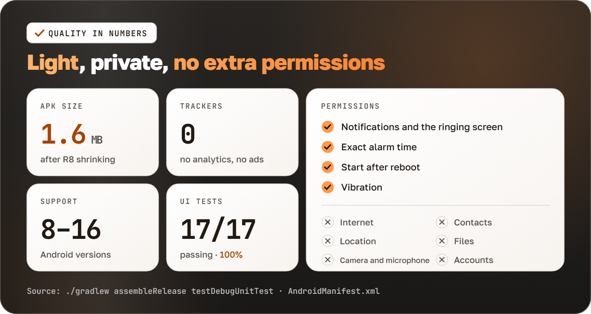

[English](README.md) · [العربية](README.ar.md) · [简体中文](README.zh-CN.md) · [繁體中文](README.zh-TW.md) · **Čeština** · [Français](README.fr.md) · [Deutsch](README.de.md) · [Ελληνικά](README.el.md) · [Bahasa Indonesia](README.id.md) · [Gaeilge](README.ga.md) · [Italiano](README.it.md) · [日本語](README.ja.md) · [한국어](README.ko.md) · [Polski](README.pl.md) · [Română](README.ro.md) · [Русский](README.ru.md) · [Español](README.es.md) · [Українська](README.uk.md) · [اردو](README.ur.md) · [ئۇيغۇرچە](README.ug.md) · [Tiếng Việt](README.vi.md) · [Português](README.pt.md) · [Türkçe](README.tr.md)

 

<picture><source srcset="https://raw.githubusercontent.com/sailxx/Budila/main/assets/readme/hero-en.svg?v=8026fb4fa174"></picture>

 

**Budila je budík Android, který vás probudí včas, bez stresu.** Jemné probuzení, štítky a barvy, charakteristický design „Instrument“ a 8 motivů Material You. Žádný přístup k internetu, žádné reklamy, žádné sledovače.

 

<picture><source srcset="https://raw.githubusercontent.com/sailxx/Budila/main/assets/readme/screens-en.svg?v=243e71ddc73d"></picture>

 

<picture><source srcset="https://raw.githubusercontent.com/sailxx/Budila/main/assets/readme/features-en.svg?v=8851a3a2ef8d"></picture>

<b>Více o funkcích</b>

### ⏰ Hlavní obrazovka

Aktuální čas a datum jsou zobrazeny ve velkém nahoře — „úterý, 6. října“. Níže je uvedeno **“Další budík”** karta: den, čas a jak dlouho zbývá. Alarmy mohou být namalovány v kterékoli z 10 barev a označeny **značky** — řada filtrů („Vše · 5“, „Práce · 2“) zobrazuje pouze ty, které potřebujete.

### ✏️ Editor

Nastavte čas na **Materiál 3 číselník** nebo pomocí klávesnice. Štítek, opakování ve všední dny, štítky (hotové nebo vlastní), barva karty, vibrace a **jemné probuzení**. Smazaný budík se vrátí jediným klepnutím.

### 🌿 Jemné probuzení

Budík se spustí téměř potichu, hlasitost se plynule zvýší asi na minutu a po 30 sekundách se spustí vibrace. Režim se zapíná a vypíná **pro každý alarm zvlášť**; nastavení rozhoduje o tom, jaké nové budíky dostanou.

### 🔔 Zvonění

Vyzváněcí obrazovka sama zapne a otevře displej **přes zamykací obrazovku**. **“Propustit”** a **“Podřimovat”** (po dobu 5–20 minut) jsou na obrazovce a v oznámení. Pokud se nikdo neozve, budík po 5–30 minutách sám ztichne.

### 🧮 “Design nástroje

Vlastní design Budila ve stylu [Okto](https://github.com/sailxx/Okto): monochromatický kryt, skutečné klávesy a zapuštěné displeje, jako technická kalkulačka. Číslice jsou JetBrains Mono s „nerozsvícenými“ osmičkami a autotestem při spuštění, čas se píše na klávesnici a vyzváněcí budík svítí červeně. 9 motivů — Klasický (světlý, tmavý, OLED ), Papír, Máta, Sakura, Půlnoc, Oceán, Nord, Crimson, Amber. Ve výchozím nastavení je zapnutá; Materiál 3 lze vrátit zpět v nastavení.

### 🎨 Témata

8 témat: **Materiál vás** z vaší tapety, Indigo, Oceán, Les, Západ slunce, Sakura, Grafit a **Zvyk** — vyberte odstín na barevném kole, sytost a styl (klidný, zářivý, výrazný, duhový…). Světlé, tmavé nebo sledujte systém, plus čistě černé pozadí pro AMOLED.

### 🌍 10 jazyků

ruština, angličtina, ukrajinština, španělština, portugalština, němčina, francouzština, italština, turečtina, polski. Na Android 13+ lze jazyk Budila vybrat nezávisle na systému.

### 🛡 Spolehlivost

Alarmy se nastavují prostřednictvím systému `AlarmClock` a zvonit včas, i když telefon spí. Po restartu nebo změně času nebo časového pásma je Budila znovu nastaví.

 

<picture><source srcset="https://raw.githubusercontent.com/sailxx/Budila/main/assets/readme/quality-en.svg?v=92b37dfdeef2"></picture>

<b>Instalovat</b>

1. Stáhnout [**Budila.apk**](https://github.com/sailxx/Budila/releases/latest/download/Budila.apk) do vašeho telefonu.
2. Otevřete soubor a povolte instalace z tohoto zdroje.
3. Při prvním spuštění povolte oznámení – bez nich se obrazovka vyzvánění nezobrazí.

Vyžaduje Android 8.0 nebo novější. Není potřeba Google Play ani účty.

Budila je také in [Obchod Komi](https://github.com/komi-store/komi-store), obchod s aplikacemi založený na vydáních GitHub: vyhledejte „ Budila “ a Komi Store sám nabídne aktualizace.

<b>Soukromí a bezpečnost</b>

Budila má **žádný přístup k internetu**: neexistuje žádný `INTERNET` povolení v manifestu. Alarmy se ukládají pouze do telefonu a nejsou zahrnuty do cloudových záloh. Žádné reklamy, žádné analýzy, žádné sledovače. Podrobnosti a způsob, jak nahlásit chybu zabezpečení, jsou uvedeny [SECURITY.md](SECURITY.md).

