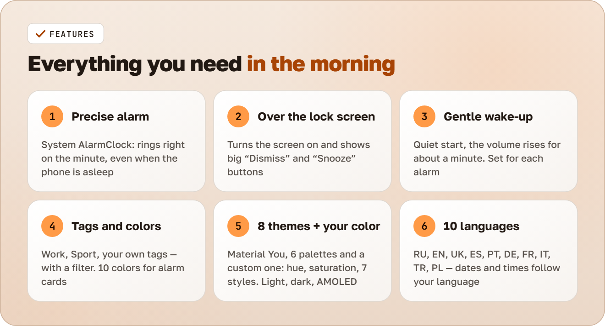

[English](README.md) · [العربية](README.ar.md) · [简体中文](README.zh-CN.md) · [繁體中文](README.zh-TW.md) · [Čeština](README.cs.md) · [Français](README.fr.md) · [Deutsch](README.de.md) · **Ελληνικά** · [Bahasa Indonesia](README.id.md) · [Gaeilge](README.ga.md) · [Italiano](README.it.md) · [日本語](README.ja.md) · [한국어](README.ko.md) · [Polski](README.pl.md) · [Română](README.ro.md) · [Русский](README.ru.md) · [Español](README.es.md) · [Українська](README.uk.md) · [اردو](README.ur.md) · [ئۇيغۇرچە](README.ug.md) · [Tiếng Việt](README.vi.md) · [Português](README.pt.md) · [Türkçe](README.tr.md)

 

<picture><source srcset="https://raw.githubusercontent.com/sailxx/Budila/main/assets/readme/hero-en.svg?v=8026fb4fa174"></picture>

 

**Το Budila είναι ένα ξυπνητήρι Android που σας ξυπνά στην ώρα σας, χωρίς άγχος.** Απαλό ξύπνημα, ετικέτες και χρώματα, το χαρακτηριστικό σχέδιο "Instrument" και 8 θέματα Material You. Χωρίς πρόσβαση στο διαδίκτυο, χωρίς διαφημίσεις, χωρίς ιχνηλάτες.

 

<picture><source srcset="https://raw.githubusercontent.com/sailxx/Budila/main/assets/readme/screens-en.svg?v=243e71ddc73d"></picture>

 

<picture><source srcset="https://raw.githubusercontent.com/sailxx/Budila/main/assets/readme/features-en.svg?v=8851a3a2ef8d"></picture>

<b>Περισσότερα για τα χαρακτηριστικά</b>

### ⏰ Κύρια οθόνη

Η τρέχουσα ώρα και ημερομηνία εμφανίζονται μεγάλα στο επάνω μέρος — «Τρίτη, 6 Οκτωβρίου». Παρακάτω είναι το **“Επόμενος συναγερμός”** κάρτα: η ημέρα, η ώρα και πόση ώρα απομένει. Οι συναγερμοί μπορούν να βαφτούν σε οποιοδήποτε από τα 10 χρώματα και να επισημανθούν με **ετικέτες** — μια σειρά φίλτρων ("Όλα · 5", "Εργασία · 2") εμφανίζει μόνο αυτά που χρειάζεστε.

### ✏️ Συντάκτης

Ρυθμίστε την ώρα στο **Υλικό 3 καντράν** ή με το πληκτρολόγιο. Ετικέτα, επανάληψη τις καθημερινές, ετικέτες (έτοιμες ή δικές σας), χρώμα κάρτας, δόνηση και **απαλό ξύπνημα**. Ένα διαγραμμένο ξυπνητήρι επανέρχεται με ένα μόνο πάτημα.

### 🌿 Ήπιο ξύπνημα

Ο συναγερμός ξεκινά σχεδόν αθόρυβα, η ένταση του ήχου αυξάνεται ομαλά για περίπου ένα λεπτό και η δόνηση αρχίζει μετά από 30 δευτερόλεπτα. Η λειτουργία ενεργοποιείται και απενεργοποιείται **για κάθε συναγερμό ξεχωριστά**; οι ρυθμίσεις αποφασίζουν τι νέοι συναγερμοί θα λάβουν.

### 🔔 Κουδούνισμα

Η οθόνη κουδουνίσματος ενεργοποιεί μόνη της την οθόνη και ανοίγει **πάνω από την οθόνη κλειδώματος**. **“Απολύω”** και **“Υπνάκος”** (για 5–20 λεπτά) βρίσκονται στην οθόνη και στην ειδοποίηση. Εάν δεν απαντήσει κανείς, ο συναγερμός σβήνει μόνος του μετά από 5–30 λεπτά.

### 🧮 “Σχεδιασμός οργάνου

Το δικό του σχέδιο του Budila στο στυλ του [Okto](https://github.com/sailxx/Okto): ένα μονόχρωμο περίβλημα, πραγματικά κλειδιά και εσοχές οθόνες, όπως μια αριθμομηχανή μηχανικής. Τα ψηφία είναι JetBrains Mono με «αφωτισμένα» οκτώ και αυτοέλεγχο κατά την εκκίνηση, η ώρα πληκτρολογείται σε ένα πληκτρολόγιο και ένας συναγερμός που κουδουνίζει ανάβει κόκκινο. 9 θέματα — Κλασικό (ανοιχτό, σκούρο, OLED ), Χαρτί, Νομισματοκοπείο, Sakura, Μεσάνυχτα, Ωκεανός, Nord, Crimson, Amber. Είναι ενεργοποιημένο από προεπιλογή. Το υλικό 3 μπορεί να επαναφερθεί στις ρυθμίσεις.

### 🎨 Θέματα

8 θέματα: **Υλικό Εσείς** από την ταπετσαρία σας, Indigo, Ocean, Forest, Sunset, Sakura, Graphite και **Εθιμο** — επιλέξτε μια απόχρωση στον τροχό χρωμάτων, τον κορεσμό και το στυλ (ήρεμο, ζωντανό, εκφραστικό, ουράνιο τόξο…). Ανοιχτό, σκοτεινό ή ακολουθήστε το σύστημα, συν ένα καθαρό μαύρο φόντο για το AMOLED.

### 🌍 10 γλώσσες

Ρωσικά, Αγγλικά, Ουκρανικά, Español, Português, Deutsch, Français, Italiano, Türkçe, Polski. Στο Android 13+ η γλώσσα του Budila μπορεί να επιλεγεί ξεχωριστά από το σύστημα.

### 🛡 Αξιοπιστία

Οι συναγερμοί ρυθμίζονται μέσω του συστήματος `AlarmClock` και κουδουνίζει έγκαιρα ακόμα και όταν το τηλέφωνο κοιμάται. Μετά από επανεκκίνηση ή αλλαγή ώρας ή ζώνης ώρας, το Budila τα ρυθμίζει ξανά.

 

<picture><source srcset="https://raw.githubusercontent.com/sailxx/Budila/main/assets/readme/quality-en.svg?v=92b37dfdeef2"></picture>

<b>Εγκαθιστώ</b>

1. Λήψη [**Budila.apk**](https://github.com/sailxx/Budila/releases/latest/download/Budila.apk) στο τηλέφωνό σας.
2. Ανοίξτε το αρχείο και επιτρέψτε τις εγκαταστάσεις από αυτήν την πηγή.
3. Κατά την πρώτη εκκίνηση, επιτρέψτε τις ειδοποιήσεις — χωρίς αυτές η οθόνη κουδουνίσματος δεν θα εμφανίζεται.

Απαιτεί Android 8.0 ή νεότερο. Δεν χρειάζονται Google Play και δεν χρειάζονται λογαριασμοί.

Το Budila είναι επίσης μέσα [Κατάστημα Komi](https://github.com/komi-store/komi-store), ένα κατάστημα εφαρμογών που βασίζεται σε εκδόσεις GitHub: αναζητήστε το " Budila " και το Komi Store θα προσφέρει ενημερώσεις από μόνο του.

<b>Απόρρητο και ασφάλεια</b>

Το Budila έχει **χωρίς πρόσβαση στο διαδίκτυο**: δεν υπάρχει `INTERNET` άδεια στο μανιφέστο. Οι συναγερμοί αποθηκεύονται μόνο στο τηλέφωνο και δεν περιλαμβάνονται στα αντίγραφα ασφαλείας του cloud. Χωρίς διαφημίσεις, χωρίς αναλυτικά στοιχεία, χωρίς ιχνηλάτες. Οι λεπτομέρειες και ο τρόπος αναφοράς μιας ευπάθειας περιλαμβάνονται [SECURITY.md](SECURITY.md).

