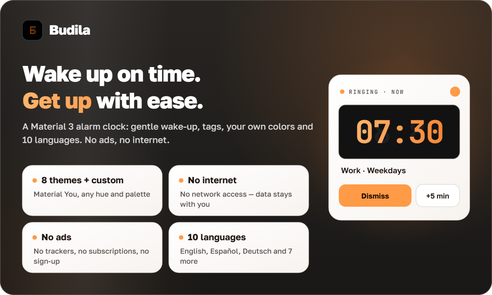

[English](README.md) · [العربية](README.ar.md) · [简体中文](README.zh-CN.md) · [繁體中文](README.zh-TW.md) · [Čeština](README.cs.md) · [Français](README.fr.md) · [Deutsch](README.de.md) · [Ελληνικά](README.el.md) · [Bahasa Indonesia](README.id.md) · [Gaeilge](README.ga.md) · [Italiano](README.it.md) · [日本語](README.ja.md) · [한국어](README.ko.md) · [Polski](README.pl.md) · **Română** · [Русский](README.ru.md) · [Español](README.es.md) · [Українська](README.uk.md) · [اردو](README.ur.md) · [ئۇيغۇرچە](README.ug.md) · [Tiếng Việt](README.vi.md) · [Português](README.pt.md) · [Türkçe](README.tr.md)

 

<picture><source srcset="https://raw.githubusercontent.com/sailxx/Budila/main/assets/readme/hero-en.svg?v=8026fb4fa174"></picture>

 

**Budila este un ceas cu alarmă Android care te trezește la timp, fără stres.** Trezire blândă, etichete și culori, design-ul „Instrument” și 8 teme Material You. Fără acces la internet, fără reclame, fără trackere.

 

<picture><source srcset="https://raw.githubusercontent.com/sailxx/Budila/main/assets/readme/screens-en.svg?v=243e71ddc73d"></picture>

 

<picture><source srcset="https://raw.githubusercontent.com/sailxx/Budila/main/assets/readme/features-en.svg?v=8851a3a2ef8d"></picture>

<b>Mai multe despre caracteristici</b>

### ⏰ Ecran principal

Ora și data curente sunt afișate mare în partea de sus — „Marți, 6 octombrie”. Mai jos este **“Următoarea alarmă”** card: ziua, ora și cât timp a mai rămas. Alarmele pot fi vopsite în oricare dintre cele 10 culori și marcate cu **etichete** — un rând de filtre („Toate · 5”, „Munca · 2”) arată doar cele de care aveți nevoie.

### ✏️ Editor

Setați ora pe **Material 3 cadran** sau cu tastatura. Etichetați, repetați în zilele lucrătoare, etichete (gata făcute sau proprii), culoarea cardului, vibrații și **trezire blândă**. O alarmă ștearsă revine cu o singură atingere.

### 🌿 Trezire blândă

Alarma pornește aproape silențioasă, volumul crește ușor timp de aproximativ un minut și vibrația se activează după 30 de secunde. Modul este pornit și dezactivat **pentru fiecare alarmă separat**; setările decid ce alarme noi primesc.

### 🔔 Sună

Ecranul care sună pornește singur afișajul și se deschide **peste ecranul de blocare**. **“Respingeți”** şi **“Amână”** (timp de 5–20 de minute) sunt pe ecran și în notificare. Dacă nimeni nu răspunde, alarma trece de la sine după 5-30 de minute.

### 🧮 “design instrument”.

Designul propriu al lui Budila în stilul lui [Okto](https://github.com/sailxx/Okto): o carcasă monocromă, chei reale și afișaje încastrate, ca un calculator de inginerie. Cifrele sunt JetBrains Mono cu opt „neluminate” și un autotest la lansare, ora este introdusă pe tastatură și o alarmă care sună se aprinde în roșu. 9 teme — Clasic (luminos, întunecat, OLED), Hârtie, Mentă, Sakura, Midnight, Ocean, Nord, Crimson, Amber. Este activat implicit; Materialul 3 poate fi adus înapoi în setări.

### 🎨 Teme

8 teme: **Material Tu** din tapetul dvs., Indigo, Ocean, Pădure, Apus de soare, Sakura, Grafit și **Personalizat** — alegeți o nuanță pe roata de culori, saturația și stilul (Calm, Vibrant, Expresiv, Curcubeu...). Lumină, întunecată sau urmează sistemul, plus un fundal negru pur pentru AMOLED .

### 🌍 10 limbi

Rusă, Engleză, Ucraineană, Español, Português, Deutsch, Français, Italiano, Türkçe, Polski. Pe Android 13+ limba lui Budila poate fi aleasă separat de sistem.

### 🛡 Fiabilitate

Alarmele sunt setate prin intermediul sistemului `AlarmClock` și sună la timp chiar și atunci când telefonul este adormit. După o repornire sau o schimbare a orei sau a fusului orar, Budila le setează din nou.

 

<picture><source srcset="https://raw.githubusercontent.com/sailxx/Budila/main/assets/readme/quality-en.svg?v=92b37dfdeef2"></picture>

<b>Instala</b>

1. Descărcați [**Budila.apk**](https://github.com/sailxx/Budila/releases/latest/download/Budila.apk) la telefonul dvs.
2. Deschideți fișierul și permiteți instalările din această sursă.
3. La prima lansare, permiteți notificările - fără ele, ecranul de apel nu va apărea.

Necesită Android 8.0 sau mai nou. Nu este Google Play și nu este nevoie de conturi.

Budila este, de asemenea, în [Magazinul Komi](https://github.com/komi-store/komi-store), un magazin de aplicații construit pe versiunile GitHub: căutați „Budila”, iar Komi Store va oferi actualizări de la sine.

<b>Confidențialitate și securitate</b>

Budila are **fara acces la internet**: nu exista `INTERNET` permisiunea în manifest. Alarmele sunt stocate doar pe telefon și nu sunt incluse în backup-urile din cloud. Fără reclame, fără analize, fără trackere. Detalii și modul de raportare a unei vulnerabilități sunt disponibile [SECURITY.md](SECURITY.md).

