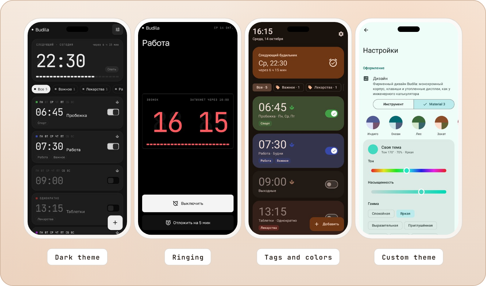

[English](README.md) · [العربية](README.ar.md) · [简体中文](README.zh-CN.md) · [繁體中文](README.zh-TW.md) · [Čeština](README.cs.md) · [Français](README.fr.md) · [Deutsch](README.de.md) · [Ελληνικά](README.el.md) · [Bahasa Indonesia](README.id.md) · [Gaeilge](README.ga.md) · [Italiano](README.it.md) · [日本語](README.ja.md) · [한국어](README.ko.md) · [Polski](README.pl.md) · [Română](README.ro.md) · [Русский](README.ru.md) · [Español](README.es.md) · [Українська](README.uk.md) · [اردو](README.ur.md) · **ئۇيغۇرچە** · [Tiếng Việt](README.vi.md) · [Português](README.pt.md) · [Türkçe](README.tr.md)

 

<picture><source srcset="https://raw.githubusercontent.com/sailxx/Budila/main/assets/readme/hero-en.svg?v=8026fb4fa174"></picture>

 

**Budila Android ئاگاھلاندۇرۇش سىگنالى بولۇپ ، سىزنى بېسىمسىز ۋاقتىدا ئويغىتىدۇ.** مۇلايىم ئويغىنىش ، بەلگە ۋە رەڭلەر ، ئىمزا «چالغۇ» لايىھىسى ۋە 8 ماتېرىيال سىز باشتېمىسى. تورغا چىقىش يوق ، ئېلان يوق ، ئىز قوغلىغۇچى يوق.

 

<picture><source srcset="https://raw.githubusercontent.com/sailxx/Budila/main/assets/readme/screens-en.svg?v=243e71ddc73d"></picture>

 

<picture><source srcset="https://raw.githubusercontent.com/sailxx/Budila/main/assets/readme/features-en.svg?v=8851a3a2ef8d"></picture>

<b>ئىقتىدارلىرى ھەققىدە تېخىمۇ كۆپ</b>

### ⏰ Main screen

نۆۋەتتىكى ۋاقىت ۋە چېسلا ئەڭ چوڭ ھالەتتە كۆرسىتىلدى - «6-ئۆكتەبىر سەيشەنبە». تۆۋەندىكىسى **“كېيىنكى ئاگاھلاندۇرۇش”** كارتا: كۈن ، ۋاقىت ۋە قانچىلىك ۋاقىت قالدى. ئاگاھلاندۇرۇشنى 10 خىل رەڭنىڭ خالىغان بىرىگە بويىغىلى ۋە بەلگە قويغىلى بولىدۇ **خەتكۈچ** — بىر قۇر سۈزگۈچ («All · 5» ، «خىزمەت · 2») پەقەت سىز ئېھتىياجلىق بولغانلىرىنىلا كۆرسىتىدۇ.

### ✏️ تەھرىر

ۋاقىتنى بەلگىلەڭ **Material 3 dial** ياكى كۇنۇپكا تاختىسى بىلەن. بەلگە ، ھەپتە كۈنلىرى ، خەتكۈچلەر (تەييار ياكى ئۆزىڭىز) ، كارتا رەڭگى ، تەۋرىنىش ۋە **مۇلايىم ئويغىنىش**. ئۆچۈرۈلگەن ئاگاھلاندۇرۇش بىر چېكىش بىلەنلا قايتىپ كېلىدۇ.

### 🌿 مۇلايىم ئويغىنىش

ئاگاھلاندۇرۇش سىگنالى دېگۈدەك باشلىنىدۇ ، ئاۋازى بىر مىنۇت ئەتراپىدا ئوڭۇشلۇق ئۆسىدۇ ، 30 سېكۇنتتىن كېيىن تەۋرىنىش قوزغىلىدۇ. بۇ ھالەت ئېچىلغان ۋە ئېتىۋېتىلگەن **ھەر بىر ئاگاھلاندۇرۇش ئۈچۈن ئايرىم**; تەڭشەكلەر يېڭى ئاگاھلاندۇرۇشنىڭ قانداق بولىدىغانلىقىنى بەلگىلەيدۇ.

### 🔔 قوڭغۇراق

قوڭغۇراق ئېكران ئېكراننى ئۆزى قوزغىتىپ ئېچىلىدۇ **قۇلۇپ ئېكرانى ئۈستىدە**. **“خىزمەتتىن ھەيدەش”** ۋە **“Snooze”** (5-20 مىنۇت) ئېكراندا ۋە ئۇقتۇرۇشتا. ئەگەر ھېچكىم جاۋاب بەرمىسە ، ئاگاھلاندۇرۇش سىگىنالى 5-30 مىنۇتتىن كېيىن ئۆزى جىمجىت بولىدۇ.

### 🧮 “چالغۇ »لايىھىسى

ئۇسلۇبتىكى Budila نىڭ ئۆزىنىڭ لايىھىسى [Okto](https://github.com/sailxx/Okto): ئىنژېنېرلىق ھېسابلىغۇچقا ئوخشاش يەككە شەكىللىك قاپ ، ھەقىقىي ئاچقۇچ ۋە باھالانغان ئېكران. رەقەملەر JetBrains Mono بولۇپ ، «ئېچىلمىغان» سەككىزلىك ۋە قويۇپ بېرىلگەندە ئۆزىنى سىنايدۇ ، ۋاقىت كۇنۇپكا تاختىسىغا يېزىلىدۇ ، قوڭغۇراق قوڭغۇراق قىزىل بولىدۇ. 9 تېما - كلاسسىك (يېنىك ، قاراڭغۇ ، OLED) ، قەغەز ، پۇل قۇيۇش زاۋۇتى ، ساكۇرا ، يېرىم كېچىدە ، ئوكيان ، شىمالىي ، كرېمسون ، ئامبېر. سۈكۈتتىكى ھالەتتە. 3-ماتېرىيالنى تەڭشەكلەرگە قايتۇرغىلى بولىدۇ.

### 🎨 باشتېمىلار

8 تېما: **Material You** تام قەغىزىڭىزدىن ، ئىندىگو ، ئوكيان ، ئورمان ، كۈن پېتىش ، ساكۇرا ، گرافىك ۋە **Custom** — رەڭلىك چاق ، تويۇنۇش ۋە ئۇسلۇبتىكى رەڭنى تاللاڭ (تىنىچ ، ھاياتىي كۈچكە تولغان ، ئىپادىلەشچان ، ھەسەن-ھۈسەن…). سۇس ، قاراڭغۇ ياكى سىستېمىغا ئەگىشىڭ ، AMOLED ئۈچۈن ساپ قارا تەگلىك قوشۇلغان.

### 🌍 10 تىل

رۇسچە ، ئىنگلىزچە ، ئۇكرائىناچە ، Español ، Português ، Deutsch ، Français ، Italiano ، Türkçe ، Polski. Android 13+ Budila نىڭ تىلىنى سىستېمىدىن ئايرىم تاللاشقا بولىدۇ.

### 🛡 ئىشەنچلىك

ئاگاھلاندۇرۇش سىستېمىسى ئارقىلىق تەڭشىلىدۇ `AlarmClock` ھەمدە تېلېفون ئۇخلىغاندىمۇ ۋاقتىدا قوڭغۇراق قىلىڭ. قايتا قوزغىتىش ياكى ۋاقىت ياكى ۋاقىت رايونى ئۆزگەرتىلگەندىن كېيىن ، Budila ئۇلارنى قايتا تەڭشەيدۇ.

 

<picture><source srcset="https://raw.githubusercontent.com/sailxx/Budila/main/assets/readme/quality-en.svg?v=92b37dfdeef2"></picture>

<b>قاچىلاش</b>

1. چۈشۈرۈش [**Budila.apk**](https://github.com/sailxx/Budila/releases/latest/download/Budila.apk) تېلېفونىڭىزغا.
2. ھۆججەتنى ئېچىڭ ۋە بۇ مەنبەدىن قاچىلاشقا يول قويۇڭ.
3. تۇنجى قوزغالغاندا ، ئۇقتۇرۇشقا يول قويۇڭ - ئۇلار بولمىسا قوڭغۇراق ئېكران كۆرۈنمەيدۇ.

Android 8.0 ياكى يېڭى نەشرىنى تەلەپ قىلىدۇ. Google Play ۋە ھېسابات يوق.

Budila مۇ بار [كومى دۇكىنى](https://github.com/komi-store/komi-store), GitHub ئاساسىدا ياسالغان بىر ئەپ دۇكىنى: «Budila» نى ئىزدەڭ ، كومى دۇكىنى ئۆزى يېڭىلاش بىلەن تەمىنلەيدۇ.

<b>مەخپىيەتلىك ۋە بىخەتەرلىك</b>

Budila بار **تورغا چىقىش يوق**: ياق `INTERNET` ئىجازەتنامە. ئاگاھلاندۇرۇش پەقەت تېلېفوندىلا ساقلىنىدۇ ، بۇلۇت زاپاسلاش دائىرىسىگە كىرمەيدۇ. ئېلان يوق ، ئانالىزمۇ يوق ، ئىز قوغلىغۇچىلارمۇ يوق. تەپسىلاتلار ۋە يوچۇقنى قانداق دوكلات قىلىش بار [SECURITY.md](SECURITY.md).

