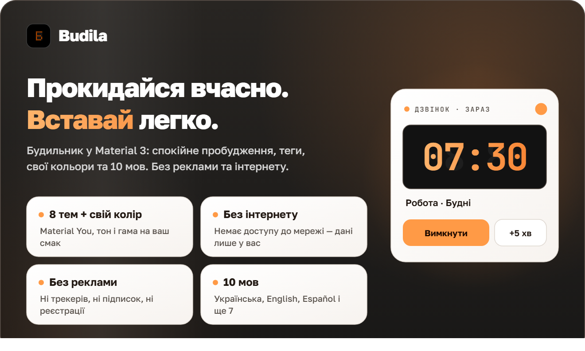
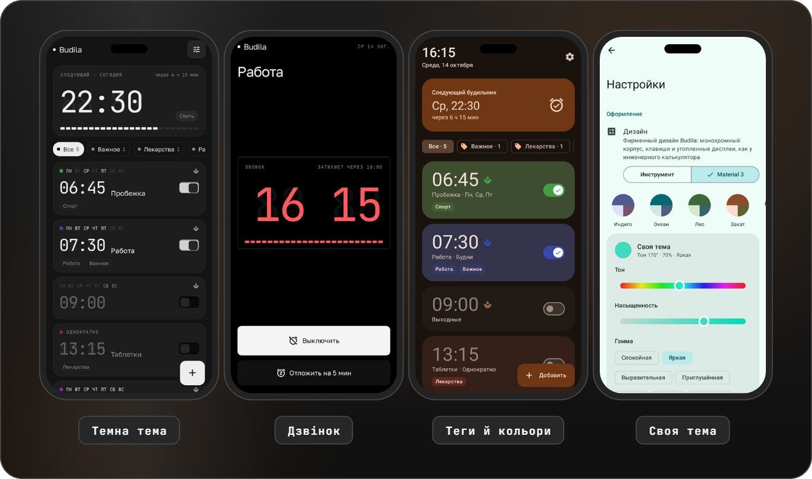
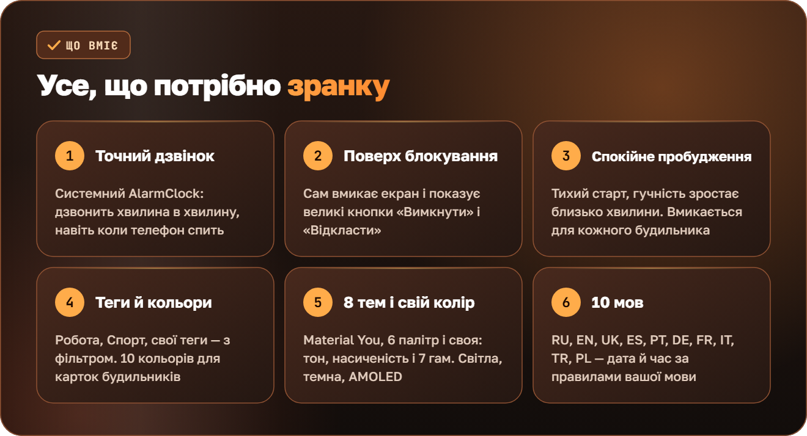
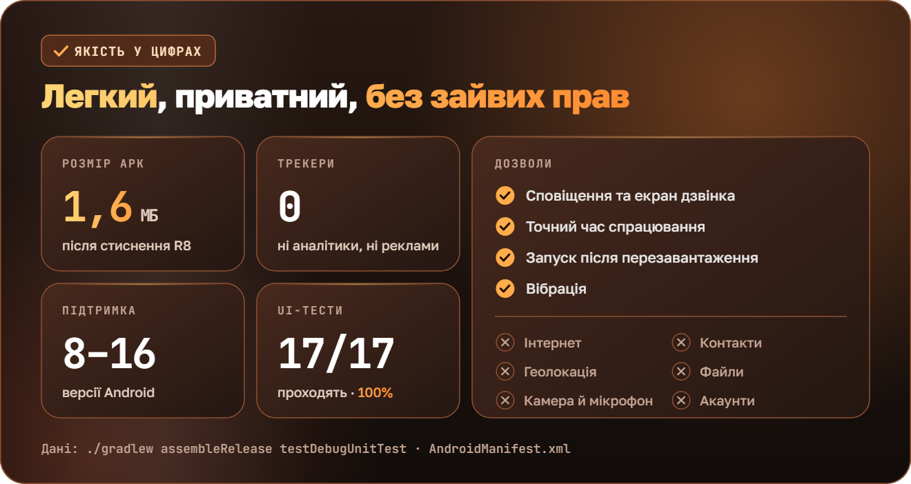

[English](README.md) · [العربية](README.ar.md) · [简体中文](README.zh-CN.md) · [繁體中文](README.zh-TW.md) · [Čeština](README.cs.md) · [Français](README.fr.md) · [Deutsch](README.de.md) · [Ελληνικά](README.el.md) · [Bahasa Indonesia](README.id.md) · [Gaeilge](README.ga.md) · [Italiano](README.it.md) · [日本語](README.ja.md) · [한국어](README.ko.md) · [Polski](README.pl.md) · [Română](README.ro.md) · [Русский](README.ru.md) · [Español](README.es.md) · **Українська** · [اردو](README.ur.md) · [ئۇيغۇرچە](README.ug.md) · [Tiếng Việt](README.vi.md) · [Português](README.pt.md) · [Türkçe](README.tr.md)

 

<picture><source srcset="https://raw.githubusercontent.com/sailxx/Budila/main/assets/readme/hero-uk.svg?v=b8c1e2cb5a14"></picture>

 

**Budila — будильник для Android, який будить вчасно і без стресу.** Спокійне пробудження, теги й кольори, фірмовий дизайн «Інструмент» і 8 тем Material You. Працює без інтернету, без реклами й трекерів.

 

<picture><source srcset="https://raw.githubusercontent.com/sailxx/Budila/main/assets/readme/screens-uk.svg?v=8ed18b90eed6"></picture>

 

<picture><source srcset="https://raw.githubusercontent.com/sailxx/Budila/main/assets/readme/features-uk.svg?v=6be1d1ccb0aa"></picture>

<b>Докладніше про можливості</b>

### ⏰ Головний екран

Угорі великим шрифтом поточний час і дата — «Вівторок, 6 жовтня». Нижче картка **«Наступний будильник»**: день, час і скільки лишилося. Будильники можна пофарбувати в будь-який із 10 кольорів і позначити **тегами** — ряд фільтрів («Усі · 5», «Робота · 2») показує лише потрібні.

### ✏️ Редактор

Час — на **циферблаті Material 3** або з клавіатури. Назва, повтор за днями тижня, теги (готові або свої), колір картки, вібрація і **спокійне пробудження**. Видалений будильник можна повернути однією кнопкою.

### 🌿 Спокійне пробудження

Дзвінок починається майже беззвучно, гучність плавно зростає близько хвилини, вібрація вмикається через 30 секунд. Режим вмикається й вимикається **для кожного будильника окремо**; у налаштуваннях задається, яким він буде в нових.

### 🔔 Дзвінок

Екран дзвінка сам вмикає дисплей і відкривається **поверх екрана блокування**. **«Вимкнути»** і **«Відкласти»** (на 5–20 хвилин) — на екрані й у сповіщенні. Якщо ніхто не відповість, дзвінок затихне сам через 5–30 хвилин.

### 🧮 Дизайн «Інструмент»

Фірмовий дизайн Budila в стилі [Okto](https://github.com/sailxx/Okto): монохромний корпус, справжні клавіші й заглиблені дисплеї, як в інженерного калькулятора. Цифри — JetBrains Mono з «незасвіченими» вісімками й самотестом під час запуску, час набирається на клавіатурі, а будильник, що дзвонить, світиться червоним. 9 тем — Класика (світла, темна, OLED), Папір, М’ята, Сакура, Північ, Океан, Норд, Кармін, Бурштин. Увімкнено за замовчуванням; у налаштуваннях можна повернути Material 3.

### 🎨 Теми

8 тем: **Material You** зі шпалер, Індиго, Океан, Ліс, Захід, Сакура, Графіт і **своя** — оберіть тон на колірному колі, насиченість і гаму (Спокійна, Яскрава, Виразна, Веселка…). Світла, темна або як у системі, а також чистий чорний фон для AMOLED.

### 🌍 10 мов

Русский, English, Українська, Español, Português, Deutsch, Français, Italiano, Türkçe, Polski. На Android 13+ мову Budila можна обрати окремо від системи.

### 🛡 Надійність

Будильники ставляться через системний `AlarmClock` і дзвонять точно, навіть коли телефон спить. Після перезавантаження, зміни часу чи часового поясу Budila розставить їх заново.

 

<picture><source srcset="https://raw.githubusercontent.com/sailxx/Budila/main/assets/readme/quality-uk.svg?v=9afdc8883adc"></picture>

<b>Встановлення</b>

1. Завантажте [**Budila.apk**](https://github.com/sailxx/Budila/releases/latest/download/Budila.apk) на телефон.
2. Відкрийте файл і дозвольте встановлення з цього джерела.
3. Під час першого запуску дозвольте сповіщення — без них не з’явиться екран дзвінка.

Потрібен Android 8.0 або новіший. Google Play та акаунти не потрібні.

Budila є і в [Komi Store](https://github.com/komi-store/komi-store) — магазині застосунків із GitHub-релізів: знайдіть «Budila» в пошуку, і Komi Store сам пропонуватиме оновлення.

<b>Приватність і безпека</b>

У Budila **немає доступу до інтернету**: у маніфесті немає дозволу `INTERNET`. Будильники зберігаються лише на телефоні й не потрапляють у хмарні резервні копії. Немає реклами, аналітики й трекерів. Подробиці та як повідомити про вразливість — у [SECURITY.md](SECURITY.md).

